# Kurio — NFT Marketplace

Aplicação web de marketplace de NFTs construída com React 19, TypeScript estrito, TanStack Router, TanStack Query, Axios, Tailwind CSS, shadcn/ui, Socket.IO e MSW (Mock Service Worker).

Documentação complementar:

- [`ARCHITECTURE.md`](./ARCHITECTURE.md) — contratos REST, eventos Socket.IO, política de sessão, cache/retries, reconciliação em tempo real, transporte MSW e decisões de UX.
- [`docs/FIGMA-DEVIATIONS.md`](./docs/FIGMA-DEVIATIONS.md) — registro detalhado das correções e complementos em relação ao Figma (`FD-01` a `FD-15`).
- [`docs/REQUISITOS-COBERTURA.md`](./docs/REQUISITOS-COBERTURA.md) — matriz de rastreabilidade item a item dos requisitos e provas automatizadas.

---

## Prévia visual e telas da plataforma

Confira abaixo as principais telas e fluxos completos desenvolvidos na plataforma:

### 1. Início e Catálogo de Coleções

> Banner hero com contagem regressiva para oferta limitada, navegação por categorias, filtros multifacetados por rede e faixa de preço em ETH, ordenação dinâmica e paginação.

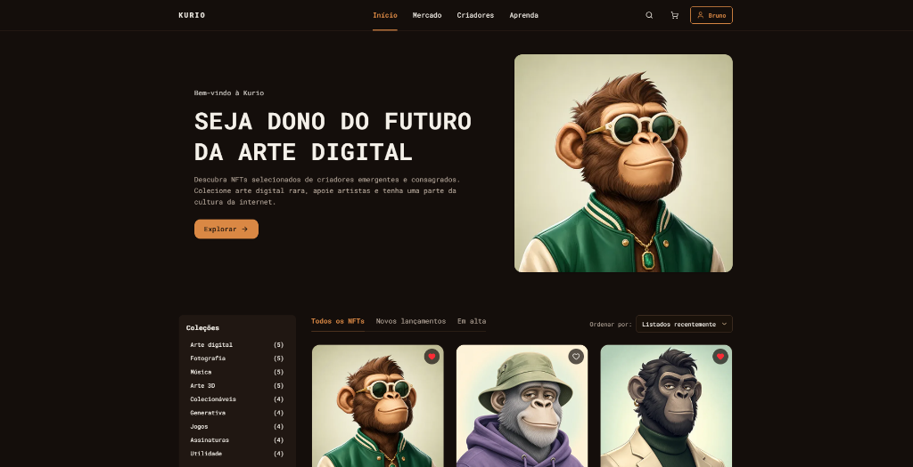

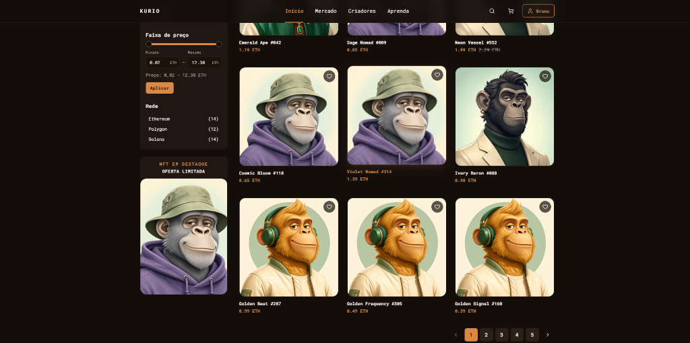

### 2. Detalhes do Ativo & Seletor de Edições

> Visualização da obra em alta resolução, histórico de valorização em gráfico interativo, atributos e raridade no IPFS, seletor de edições (1/1, 1/10, 1/50 e aberta) e ações de compra e favoritar.

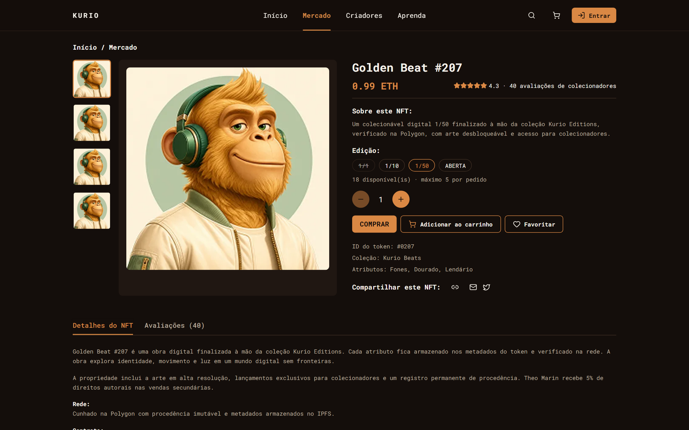

### 3. Carrinho de Compras e Resumo Financeiro

> Gestão de múltiplos itens com alteração de quantidade em tempo real, aplicação de cupom promocional (`KURIO10`), cálculo de taxas de rede e estimativas em ETH com precisão decimal.

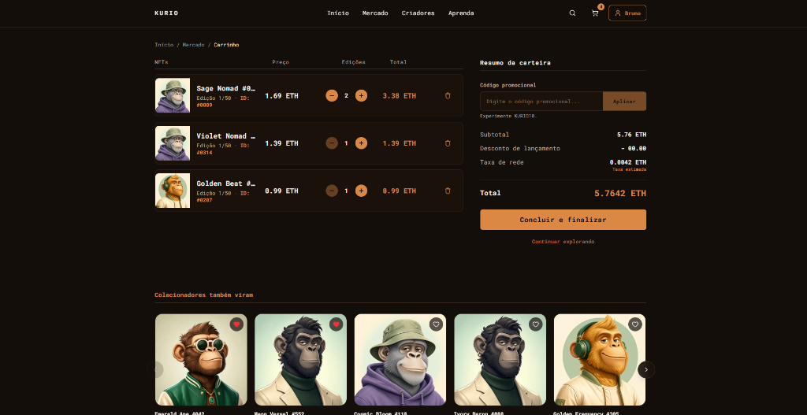

### 4. Checkout Web3, Revisão e Confirmação da Transação

> Conexão simulada de carteira Web3 (MetaMask/Ethereum), modal de revisão com proteção contra oscilação de cotação e recibo oficial emitido com ID da transação após confirmação na rede.

|                   Checkout e Carteira Conectada                    |                 Modal de Revisão do Pedido                 |
| :----------------------------------------------------------------: | :--------------------------------------------------------: |
| 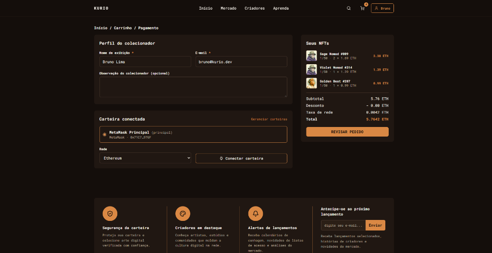 | 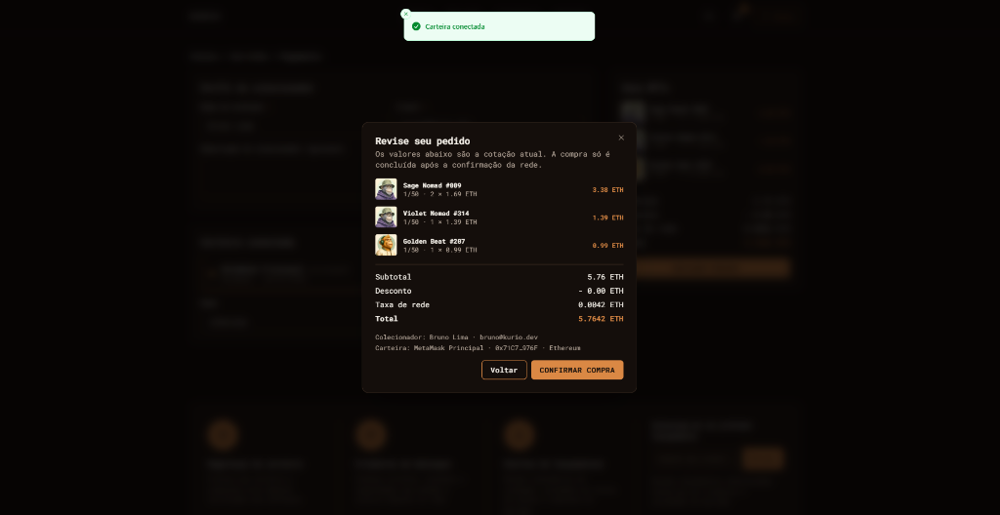 |

|               Recibo e Confirmação da Transação               |         Lista de Favoritos Sincronizada         |
| :-----------------------------------------------------------: | :---------------------------------------------: |
| 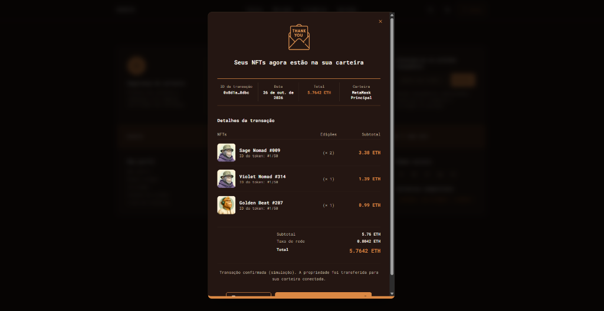 | 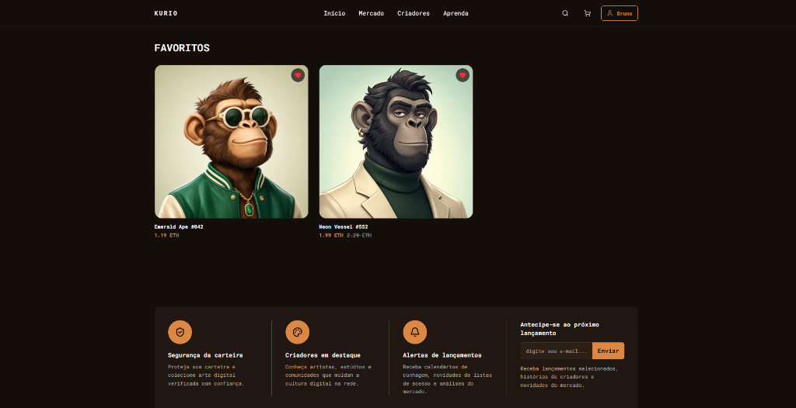 |

### 5. Painel de Simulação (MSW / Socket.IO) e Responsividade Mobile

> Painel lateral de testes determinísticos para simular 13 cenários de rede (offline, jitter, flutuação de preço, timeout, 503) e disparar eventos Socket.IO em tempo real. Interface 100% responsiva (390px, 768px e 1440px) sem overflow horizontal.

|              Painel de Simulação (MSW & Socket.IO)               |                    Experiência Mobile (390px)                     |
| :--------------------------------------------------------------: | :---------------------------------------------------------------: |
| 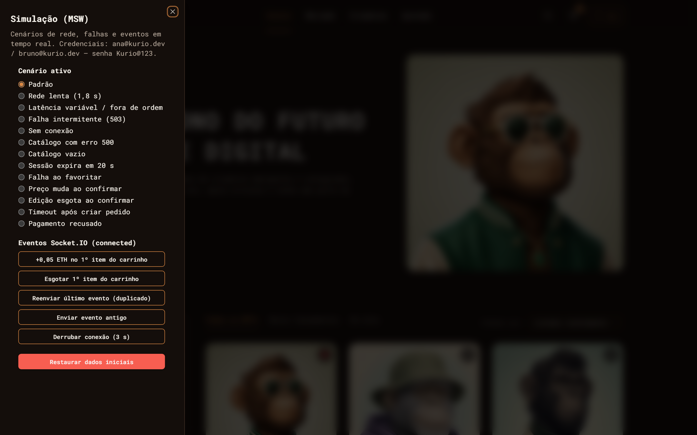 | 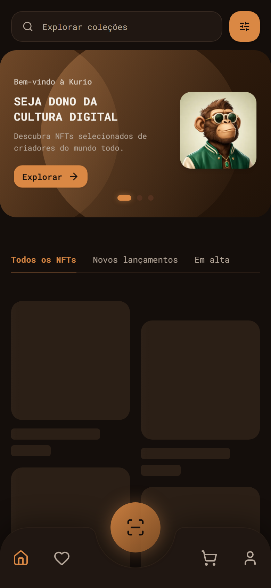 |

### 6. Perfil e Gestão de Múltiplas Carteiras

> Edição de dados do colecionador (nome de exibição, domínio ENS `.eth`, avatar e alteração de senha segura) e gerenciamento de carteira primária e secundárias por rede.

|           Dados do Perfil do Colecionador           |                   Gestão de Carteiras                   |
| :-------------------------------------------------: | :-----------------------------------------------------: |
| 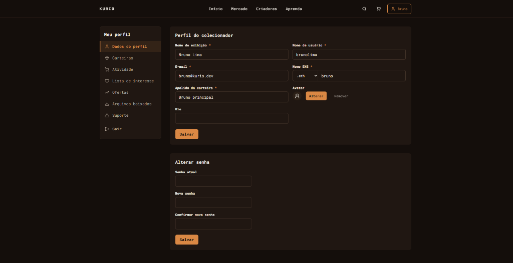 | 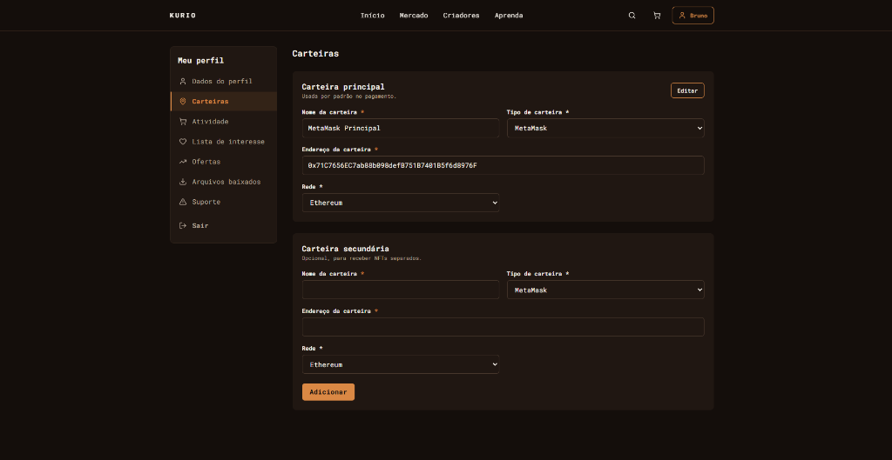 |

---

## 1. Requisitos e instalação

Requer [Bun](https://bun.sh/) (v1.1+) e Google Chrome instalado localmente para execução dos testes E2E Playwright e auditorias Lighthouse.

```sh
bun install
bun run dev
```

O servidor de desenvolvimento inicia com os mocks REST e Socket.IO ativos por padrão.

---

## 2. Variáveis de ambiente

As variáveis abaixo têm valores padrão seguros para execução local e build de demonstração (nenhum arquivo `.env` obrigatório para rodar o projeto):

| Variável               | Padrão                                | Descrição                                                                                                                                 |
| ---------------------- | ------------------------------------- | ----------------------------------------------------------------------------------------------------------------------------------------- |
| `VITE_ENABLE_MOCKS`    | `"true"` (ativo quando `!== "false"`) | Ativa o Service Worker do MSW e o servidor Socket.IO simulado no navegador, inclusive em `vite build` / `vite preview`.                   |
| `VITE_SHOW_MOCK_PANEL` | `"false"`                             | Quando `"true"`, exibe o botão flutuante **Cenários** para alternar cenários determinísticos e disparar eventos Socket.IO pela interface. |
| `VITE_API_URL`         | `"/api"`                              | Prefixo base usado pelo cliente Axios (`src/api/client.ts`).                                                                              |

Para iniciar o servidor de desenvolvimento com o painel visual de simulação aberto:

```sh
VITE_SHOW_MOCK_PANEL=true bun run dev
```

No PowerShell (Windows):

```powershell
$env:VITE_SHOW_MOCK_PANEL="true"; bun run dev
```

---

## 3. Credenciais fictícias e cupons de teste

### Contas pré-cadastradas

| Usuário        | E-mail            | Senha       | Características iniciais                                                                                                                 |
| -------------- | ----------------- | ----------- | ---------------------------------------------------------------------------------------------------------------------------------------- |
| **Ana Sato**   | `ana@kurio.dev`   | `Kurio@123` | Possui favorito inicial (`emerald-ape-042`), metadados ENS (`ana.eth`) e carteira inicial cadastrada (Ethereum MetaMask "Reserva").      |
| **Bruno Lima** | `bruno@kurio.dev` | `Kurio@123` | Conta limpa (sem favoritos nem carteiras iniciais) para testar estados vazios, primeiro cadastro de carteira e isolamento entre sessões. |

### Cupons promocionais

| Código                             | Comportamento                                                             |
| ---------------------------------- | ------------------------------------------------------------------------- |
| `KURIO10`                          | Válido — aplica **10% de desconto** (`1000 bps`) sobre o subtotal em ETH. |
| `WELCOME5`                         | Válido — aplica **5% de desconto** (`500 bps`) sobre o subtotal em ETH.   |
| `VERAO25`                          | Expirado — retorna erro `422 COUPON_EXPIRED` (`"Este cupom expirou"`).    |
| Qualquer outro (ex.: `INVALIDO99`) | Inválido — retorna erro `422 COUPON_INVALID` (`"Cupom inválido"`).        |

---

## 4. Seleção e reset de cenários determinísticos

> [!TIP]
> **Acesso interativo na demonstração (Vercel):**
> Para abrir o painel visual flutuante no site publicado sem precisar configurar nada localmente, acesse:
> 👉 **[https://frontend-challenge-junglegamig.vercel.app/?panel=true](https://frontend-challenge-junglegamig.vercel.app/?panel=true)**
> Um botão flutuante **Cenários** (com ícone de laboratório) surgirá no canto inferior esquerdo da tela permitindo alternar cenários em 1 clique e disparar eventos de tempo real.

> [!IMPORTANT]
> **A cada quantas requisições o servidor simula falhas de conexão?**
>
> - **Cenário `default` (Padrão):** **0% de falhas induzidas**. Nenhuma requisição falha artificialmente; opera com latência estável realista (120–300 ms).
> - **Cenário `flaky` (Falha intermitente):** **Exatamente 1 a cada 3 requisições (`n % 3 === 0`)** falha com HTTP `503 UNAVAILABLE` ("Serviço temporariamente indisponível"). O TanStack Query executa até **2 retries automáticos** com recuo exponencial antes de apresentar erro na UI.
> - **Cenário `offline` (Sem conexão):** **100% das requisições** falham imediatamente com erro de rede (`NETWORK: "Sem conexão com o servidor"`).
> - **Cenário `order-timeout`:** a primeira tentativa de confirmação de compra estoura o timeout de **8 segundos** do cliente Axios.
> - **Cenário `session-expired`:** a sessão do usuário expira após **20 segundos** de inatividade.
> - **Botão "Derrubar conexão" (Painel):** desconecta o WebSocket do Socket.IO durante **3 segundos** para testar a reconexão automática e reconciliação REST.
>
> **Por que falhas continuam acontecendo se você ativou um cenário? (Persistência no localStorage):**
> O banco de dados do mock e o cenário ativo ficam salvos no `localStorage` do navegador (`kurio.mockdb.v1`). Portanto, se você selecionou `flaky` ou `offline`, essa simulação **permanece ativa** mesmo ao navegar ou recarregar a página (F5)!
>
> **Como restaurar a operação normal (0% de falha):**
>
> 1. Pelo painel flutuante: abra **Cenários** e clique em **Padrão** ou no botão vermelho **Restaurar dados iniciais**.
> 2. Pela URL: acesse qualquer rota com `?scenario=default` (ex.: `https://frontend-challenge-junglegamig.vercel.app/?scenario=default`).

Os cenários de rede e de negócio podem ser selecionados de três formas:

1. **Pelo painel de simulação (`Cenários` — Recomendado):** acesse qualquer rota com `?panel=true` ou `?cenarios=true` (ex.: `https://frontend-challenge-junglegamig.vercel.app/?panel=true`) ou inicie localmente com `VITE_SHOW_MOCK_PANEL=true`. Um botão flutuante **Cenários** surgirá no canto inferior esquerdo para alternar cenários em tempo real, disparar eventos Socket.IO ou clicar em **Restaurar dados iniciais**. A preferência fica gravada no navegador (`?panel=false` para ocultar).
2. **Pela URL direta (`?scenario=<id>`):** adicione `?scenario=<id>` ao abrir qualquer rota (ex.: `/?scenario=slow`, `/?scenario=empty`, `/login?scenario=price-change`). O inicializador do MSW aplica o cenário e reseta os contadores antes de atender a primeira requisição da página.
3. **Por endpoint de controle (testes):** `POST /api/__mock/reset` (opcionalmente com `{ "scenario": "<id>" }`) restaura o banco determinístico no `localStorage`, e `POST /api/__mock/scenario` altera apenas o cenário ativo sem apagar sessão ou carrinho.

### Detalhamento e cadência de cada cenário e falha simulada

| Cenário (`?scenario=`)                    | Cadência / Frequência exata da falha                                                                             | Comportamento simulado e validação na interface                                                                                                                                                                                |
| ----------------------------------------- | ---------------------------------------------------------------------------------------------------------------- | ------------------------------------------------------------------------------------------------------------------------------------------------------------------------------------------------------------------------------ |
| `default`                                 | **0% de falhas** (estável)                                                                                       | Operação normal com latência realista (120–300 ms) e confirmações de pedido em ~2,5 s via Socket.IO.                                                                                                                           |
| `flaky`                                   | **1 a cada 3 requisições (`n % 3 === 0`)** (requisições 3ª, 6ª, 9ª, 12ª...)                                      | Retorna `503 UNAVAILABLE` ("Serviço temporariamente indisponível"). Exercita o retry automático (até 2 tentativas com backoff exponencial) do TanStack Query sem interromper a navegação.                                      |
| `offline`                                 | **100% das requisições**                                                                                         | Simula falha imediata de transporte de rede (`NETWORK: "Sem conexão com o servidor"`). Valida o estado desconectado da aplicação.                                                                                              |
| `slow`                                    | **100% das requisições**                                                                                         | Aplica atraso fixo de **1,8 s** (1800 ms), permitindo inspecionar visualmente os skeletons `.shimmer` no catálogo, detalhe e resumo do carrinho sem layout shift.                                                              |
| `jitter`                                  | **100% das requisições**                                                                                         | Latência variável e fora de ordem entre **100 e 1500 ms** (`100 + ((n * 7919) % 1400)`). Valida o descarte e cancelamento de requisições anteriores (`AbortSignal`) ao alternar abas e filtros rapidamente.                    |
| `server-error`                            | Na rota `GET /api/nfts`                                                                                          | Retorna `500 SERVER_ERROR`. A tela de catálogo exibe aviso amigável de erro com botão **"Tentar novamente"** para recuperação.                                                                                                 |
| `session-expired`                         | **Após exatamente 20 segundos**                                                                                  | A sessão recebe TTL curto de 20 s. Ao expirar, a API retorna `401 SESSION_EXPIRED`, o app limpa o cache privado e redireciona para `/login?redirect=...&expired=true`, preservando o rascunho do checkout no `sessionStorage`. |
| `order-timeout`                           | Na 1ª tentativa de confirmação                                                                                   | A primeira requisição de criação de pedido excede o timeout de 8 s do Axios. Clicar em **"Tentar novamente"** reenvia a mesma `Idempotency-Key` e recupera o pedido já criado sem duplicar compras.                            |
| `favorite-fail`                           | Ao favoritar um item                                                                                             | Retorna `500 SERVER_ERROR`. A interface aplica otimisticamente a alteração no coração e executa **rollback imediato** ao receber o erro, exibindo aviso acessível.                                                             |
| `price-change`                            | Ao confirmar a compra no modal                                                                                   | O preço do item sobe `+0,10 ETH` antes de fechar (`409 QUOTE_STALE`), exibindo os novos valores com destaque e exigindo confirmação explícita.                                                                                 |
| `sold-out`                                | Ao confirmar a compra no modal                                                                                   | A edição esgota antes de fechar (`409 AVAILABILITY`), bloqueando a compra e exibindo alerta de estoque esgotado.                                                                                                               |
| `payment-declined`                        | Após **2,5 segundos** da criação                                                                                 | O pedido nasce `pending` e transita via Socket.IO para `declined` (Pagamento recusado), preservando os itens originais no carrinho para nova tentativa.                                                                        |
| `empty`                                   | Na rota `GET /api/nfts`                                                                                          | O catálogo retorna 0 itens para validar o estado visual vazio e o botão de limpar filtros.                                                                                                                                     |
| **Eventos Socket.IO** (painel `Cenários`) | Ao clicar em **+0,05 ETH**, **Esgotar**, **Reenviar duplicado**, **Enviar antigo** ou **Derrubar conexão (3 s)** | Dispara eventos reais pelo WebSocket interceptado para validar deduplicação por `eventId`/`version`, reconciliação REST após reconexão e revalidação do carrinho.                                                              |

---

## 5. Comandos disponíveis

```sh
# Servidor de desenvolvimento (Vite)
bun run dev

# Verificação de tipos TypeScript (tsc --noEmit)
bun run typecheck

# Lint do projeto (ESLint + Prettier)
bun run lint

# Formatação de código (Prettier)
bun run format

# Testes unitários e de integração (Vitest)
bun run test
bun run test:watch

# Build de produção e servidor de preview
bun run build
bun run preview

# Testes E2E (Playwright — Chromium Desktop 1440×1000 e Mobile 390×844)
bun run test:e2e
bun run test:e2e:ui

# Executar testes E2E sobre o build compilado de produção (preview)
PLAYWRIGHT_PREVIEW=1 bun run test:e2e

# Auditoria de performance, acessibilidade, boas práticas e SEO (Lighthouse)
bun run lighthouse
```

---

## 6. Deploy público

A aplicação usa SSR com TanStack Start e Nitro. Na Vercel, `vercel.json` declara o framework
`tanstack-start`, e o adaptador Nitro detecta o ambiente para gerar a função de servidor e os
assets no formato nativo da plataforma. Não configure `.output/public` como diretório de saída
estático nem reescreva todas as rotas para `/`: isso remove o servidor SSR do deploy e quebra o
acesso direto a páginas como `/nft/emerald-ape-042`.

Produção: [https://frontend-challenge-junglegamig.vercel.app/](https://frontend-challenge-junglegamig.vercel.app/).

Demonstração com painel de cenários ativo: [https://frontend-challenge-junglegamig.vercel.app/?panel=true](https://frontend-challenge-junglegamig.vercel.app/?panel=true).

Os mocks MSW e o transporte de tempo real operam no cliente também na versão publicada. Em hosts
estáticos, `public/_redirects` contém uma regra SPA, mas o build padrão deste projeto é SSR; use
uma integração de servidor compatível com TanStack Start/Nitro para publicar esse build.
